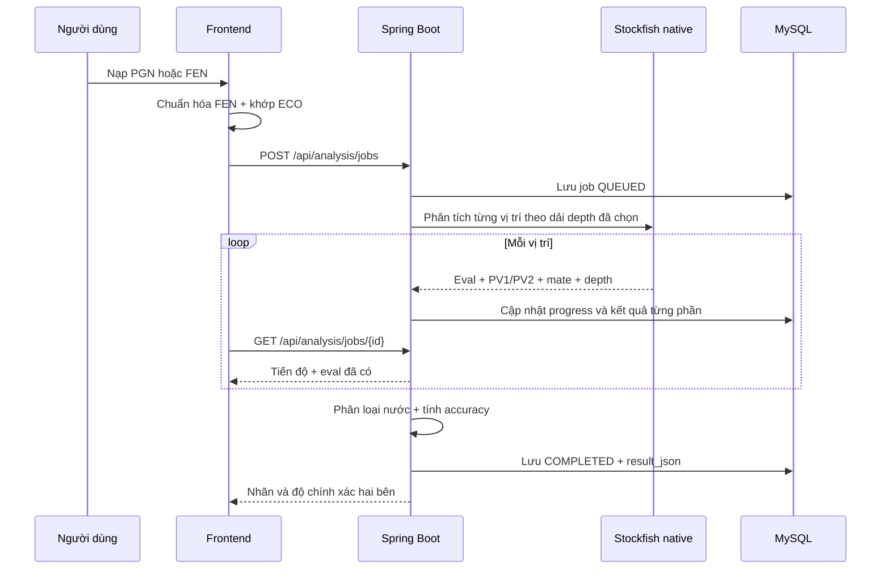
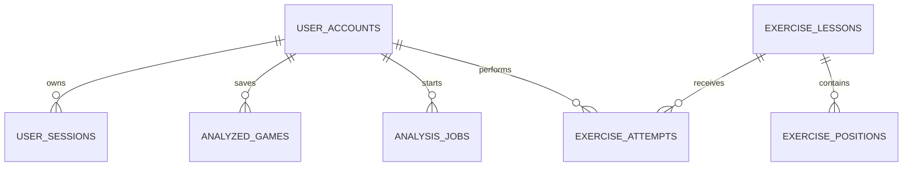

# Kiến trúc Chess Analysis

## Phân chia trách nhiệm

| Thành phần | Trách nhiệm |
| --- | --- |
| React/Vinext + chess.js | Giao diện, kiểm tra nước hợp lệ, chuẩn hóa PGN thành timeline FEN và hiển thị kết quả |
| Stockfish Web Worker | Chỉ phân tích thao tác tự đi tức thời ở depth 16 |
| ECO JSON | Nhận diện khai cuộc và biến thể ngay theo chuỗi nước |
| Spring Boot + Stockfish native | Hàng đợi Game Review, depth tùy chọn 10–14/16–20, PV1/PV2, nhãn, accuracy và chấm bài tàn cuộc |
| MySQL/Flyway | Tài khoản, phiên, kho ván, analysis jobs, bài học, thế cờ và lịch sử luyện tập |

## Luồng Game Review backend



Sau khi review, frontend giữ một `reviewTimeline` bất biến. Nếu người dùng đi khác ở bất kỳ nước nào, một `variationTimeline` được tạo từ đúng điểm rẽ. Web Worker chỉ phân tích các vị trí của biến thử ở depth 16, còn kết quả backend, accuracy và lịch sử ván gốc vẫn tồn tại để chuyển qua lại tức thời.

Người dùng chọn Nhanh 10–14 hoặc Sâu 16–20. Trong mỗi dải, khai cuộc/lý thuyết dùng mức thấp nhất, trung cuộc yên tĩnh dùng mức giữa, nước bắt quân/chiếu dùng gần mức cao nhất, còn tàn cuộc ít quân và FEN đơn dùng mức cao nhất. ECO không thay thế Stockfish: mọi vị trí vẫn được đánh giá để báo cáo có thể tái lập.

## Quy tắc nhãn backend

1. Chiếu hết luôn là `Best`.
2. Chỉ có một nước hợp lệ là `Forced`.
3. Chuỗi còn nằm trong ECO là `Theory`.
4. `Brilliant` bắt buộc là PV1 có thí vật chất thật (không phải quân chỉ đang bị tấn công), không làm xấu thế trận và xuất hiện khi vị trí còn cạnh tranh; thế đã thắng áp đảo chỉ nhận `Best`.
5. PV1 có khoảng cách rõ với PV2, không hiển nhiên và giữ lợi thế là `Critical`.
6. Các nhãn còn lại dùng suy giảm xác suất thắng và centipawn loss.

Accuracy dùng mức giảm xác suất thắng giữa đánh giá trước/sau nước đi, cùng công thức:

```text
accuracy = 103.1668 × exp(-0.04354 × chanceLoss) - 3.1669
```

Kết quả được giới hạn trong 0–100; nước lý thuyết được tính 100.

## Luồng bài tập tàn cuộc

Backend chọn ngẫu nhiên một hàng trong `exercise_positions`. Người dùng đi nước hợp lệ trên frontend; Spring Boot gọi Stockfish depth 20 để so nước đã đi với PV1 và ưu tiên đường chiếu hết nhanh. Kết quả được hiển thị bằng cùng hệ icon nhãn của trang phân tích và gắn ở góc trên bên phải ô đích. Với nước chưa chuẩn, frontend giữ nguyên vị trí và hiển thị nước tốt nhất có thể bấm để triển khai. Với nước được chấp nhận, PV1 của thế sau được dùng làm nước đáp của Stockfish. Khi đạt mục tiêu chiếu hết, phong cấp, thắng xe hoặc hòa, backend lưu điểm vào `exercise_attempts` nếu người dùng đã đăng nhập.

## Mô hình dữ liệu chính



Kho ván vẫn được bảo vệ theo `user_id` từ cookie phiên. Analysis job có `public_id` UUID để thăm dò tiến độ mà không lộ khóa tăng dần của database.
