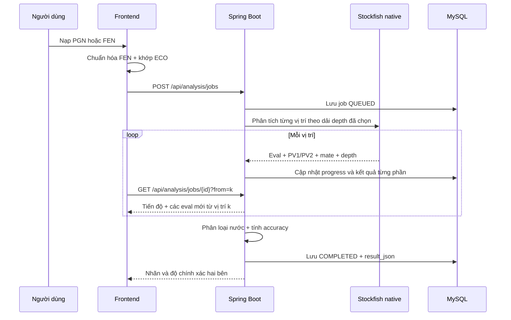
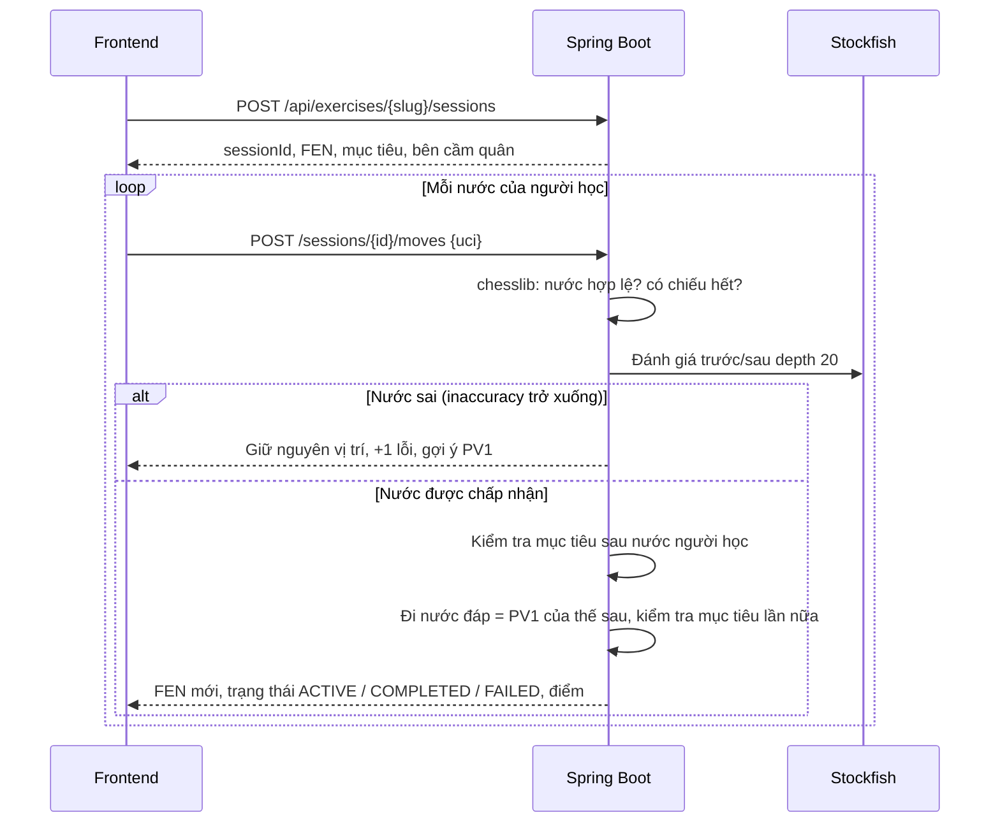
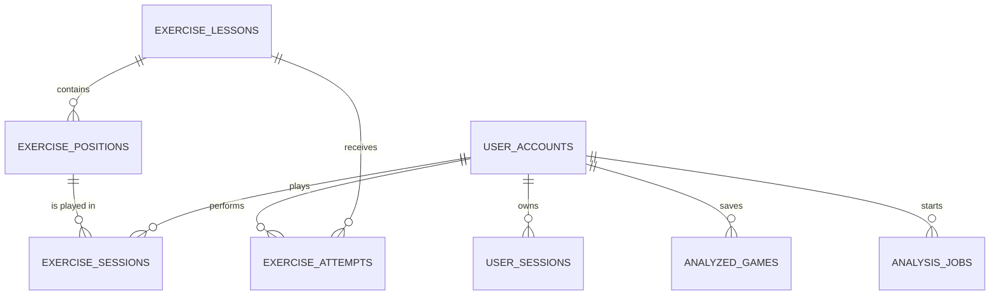

# Kiến trúc Chess Analysis

## Phân chia trách nhiệm

| Thành phần | Trách nhiệm |
| --- | --- |
| Next.js 16 + chess.js | Giao diện, kiểm tra nước hợp lệ, chuẩn hóa PGN thành timeline FEN và hiển thị kết quả |
| Stockfish Web Worker | Chỉ phân tích thao tác tự đi tức thời ở depth 16; dùng bản WASM (nhanh hơn asm.js ~5,5 lần), tự lùi về asm.js nếu WASM không khởi động được |
| ECO JSON | Nhận diện khai cuộc và biến thể ngay theo chuỗi nước |
| Spring Boot + Stockfish native | Hàng đợi Game Review, depth tùy chọn 10–14/16–20, PV1/PV2, nhãn, accuracy và chấm bài tàn cuộc |
| MySQL/Flyway | Tài khoản, phiên, kho ván, analysis jobs, bài học, thế cờ và lịch sử luyện tập |

## Luồng Game Review backend



Sau khi review, frontend giữ một `reviewTimeline` bất biến. Nếu người dùng đi khác ở bất kỳ nước nào, một `variationTimeline` được tạo từ đúng điểm rẽ. Web Worker chỉ phân tích các vị trí của biến thử ở depth 16, còn kết quả backend, accuracy và lịch sử ván gốc vẫn tồn tại để chuyển qua lại tức thời.

Người dùng chọn Nhanh 10–14 hoặc Sâu 16–20. Depth đi theo giai đoạn ván: khai cuộc (ít nhất 12 nửa nước đầu, kéo dài theo chuỗi nước lý thuyết liên tục từ đầu ván) dùng mức thấp nhất, trung cuộc dùng mức giữa, tàn cuộc (≤ 14 quân) và FEN đơn dùng mức cao nhất. Vì cả ba điều kiện chỉ đi một chiều theo thời gian, depth đổi tối đa hai lần trong một ván, nên hai vị trí trước/sau của hầu hết các nước được đánh giá cùng depth và chênh lệch depth không bị tính nhầm thành lỗi người chơi. ECO không thay thế Stockfish: mọi vị trí vẫn được đánh giá để báo cáo có thể tái lập.

Hàng đợi nằm trong bộ nhớ. Khi máy chủ khởi động lại, job còn QUEUED/RUNNING trong vòng một giờ được xếp hàng lại từ `request_json`; các vị trí đã phân tích nằm sẵn trong cache `position_evaluations` nên lần chạy lại nhanh. Job cũ hơn bị đánh dấu thất bại.

## Quy tắc nhãn backend

1. Chiếu hết luôn là `Best`.
2. Chỉ có một nước hợp lệ là `Forced`.
3. Chuỗi còn nằm trong ECO **và** engine đánh giá mất dưới 5% cơ hội thắng là `Theory`. Sách ECO có cả những dòng yếu (Grob, Barnes…), nên nước trong sách mà engine thấy là sai sót sẽ được chấm như nước thường.
4. `Brilliant` bắt buộc là PV1 có thí vật chất thật (không phải quân chỉ đang bị tấn công), không làm xấu thế trận và xuất hiện khi vị trí còn cạnh tranh; thế đã thắng áp đảo chỉ nhận `Best`.
5. PV1 có khoảng cách rõ với PV2, không hiển nhiên và giữ lợi thế là `Critical`.
6. Các nhãn còn lại chỉ dựa trên mức mất cơ hội thắng (win%) của bên vừa đi:

| Mất win% | Nhãn |
| --- | --- |
| < 2 | Excellent |
| 2 – < 5 | Okay |
| 5 – < 10 | Inaccuracy |
| 10 – < 15 | Mistake |
| ≥ 15 | Blunder |

Ba mốc 5/10/15 trùng với Lichess (0,1/0,2/0,3 trên thang winning chances [-1, 1]).

Win% của Trắng: `win% = 100 / (1 + exp(-0.00368208 × cp))`, với cp kẹp trong ±1000.

Accuracy **từng nước** dùng mức giảm win% giữa đánh giá trước/sau nước đi:

```text
accuracy = 103.1668 × exp(-0.04354 × chanceLoss) - 3.1669     (kẹp 0–100)
```

Accuracy **toàn ván** của mỗi bên theo cách tiếp cận của Lichess, là trung bình của hai đại lượng:

- **Trung bình có trọng số**: trọng số của mỗi nước là độ lệch chuẩn win% trong cửa sổ trượt quanh nước đó (kích thước cửa sổ = số nước / 10, kẹp 2–8; trọng số kẹp 0,5–12), nên nước đi trong giai đoạn thế cờ biến động được tính nặng hơn.
- **Trung bình điều hòa** các accuracy (mỗi giá trị chặn dưới ở 1), nhạy với nước tệ nên một blunder quyết định không bị hàng chục nước dễ che lấp.

Trung bình cộng thông thường (cách cũ) thổi phồng accuracy của các ván có nhiều nước yên tĩnh.

## Luồng bài tập tàn cuộc

Bài tàn cuộc chạy hoàn toàn trên server, theo phiên (`exercise_sessions`):



Mục tiêu được kiểm tra hai lần mỗi lượt, lần thứ hai **sau nước đáp** của engine:

| Mục tiêu | Hoàn thành khi |
| --- | --- |
| CHECKMATE | Đối phương bị chiếu hết |
| PROMOTE | Nước được chấp nhận là nước phong cấp |
| WIN_ROOK | Đối phương hết xe **và** người học vẫn còn hậu (đổi hậu lấy xe không tính) |
| DRAW | Ván hòa theo luật, hoặc trụ được 10 nước không sai |

Hòa (stalemate, thiếu quân, lặp ba lần) trong bài không phải DRAW, hoặc bị chiếu hết, thì phiên thất bại. Server dựng lại ván từ đầu ở mỗi nước nên phát hiện được lặp ba lần. Khi hoàn thành, server tự tính điểm `max(40, 100 − 15 × số nước sai)` và lưu vào `exercise_attempts` nếu người dùng đã đăng nhập; client không gửi điểm.

Dữ liệu 30 thế tàn cuộc được `EndgameSeedDataTest` dựng lại từ các migration và kiểm tra: FEN hợp lệ, bên đến lượt có nước đi, chưa hòa sẵn, và bài cầm hòa không mở đầu bằng thế chiếu hết một nước.

## Mô hình dữ liệu chính



Kho ván vẫn được bảo vệ theo `user_id` từ cookie phiên. Analysis job có `public_id` UUID để thăm dò tiến độ mà không lộ khóa tăng dần của database.
