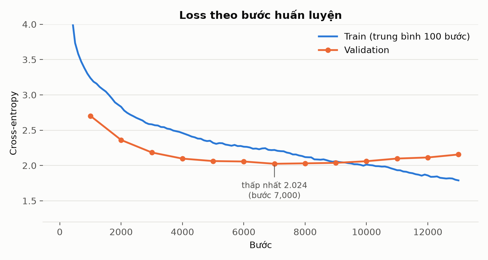
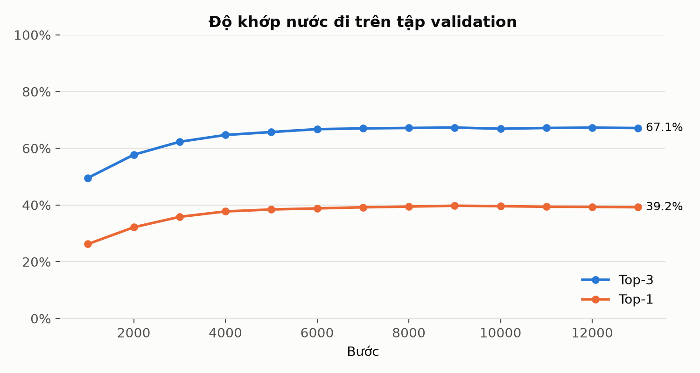
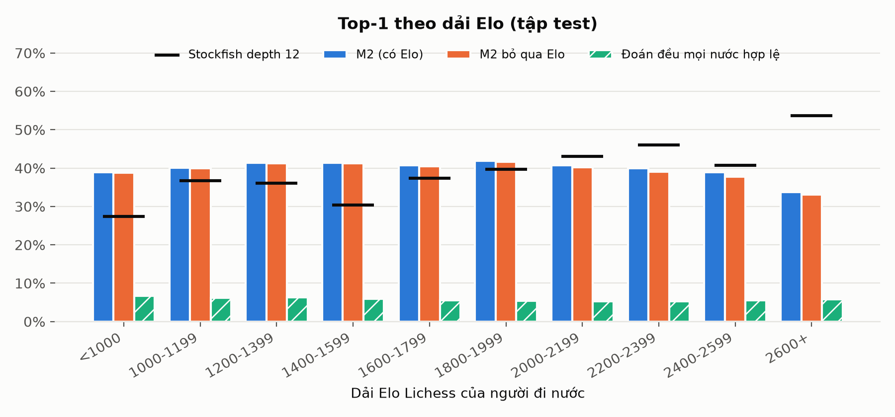
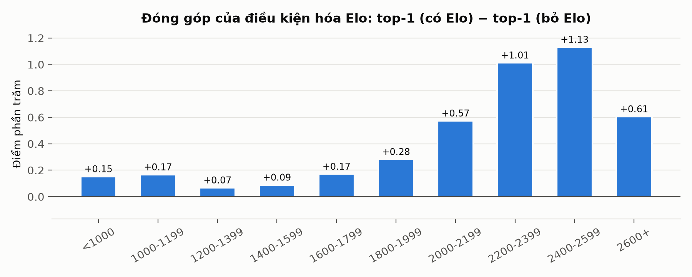
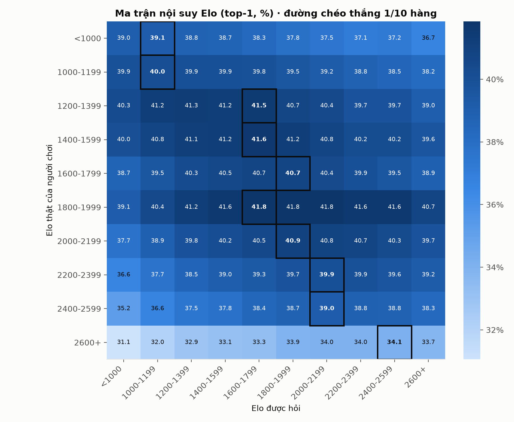
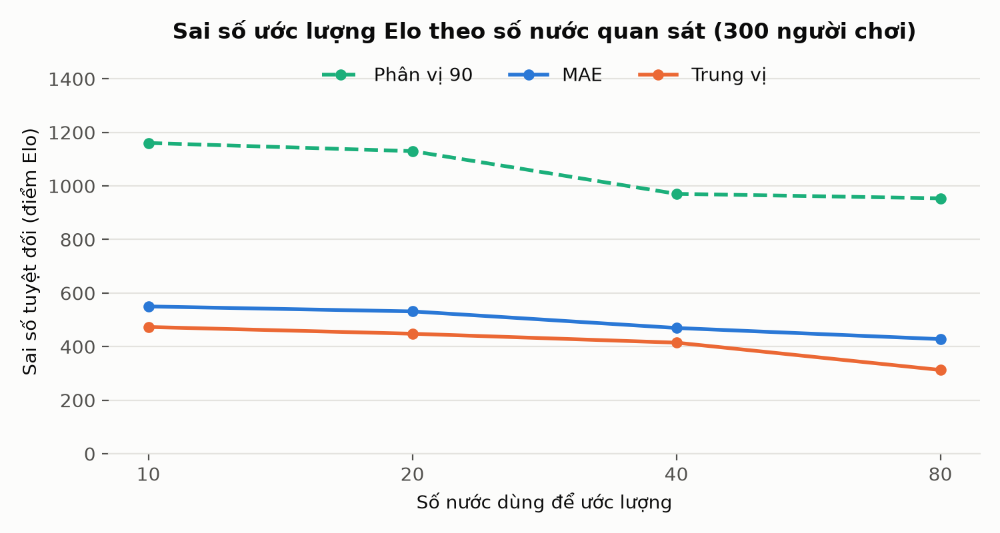
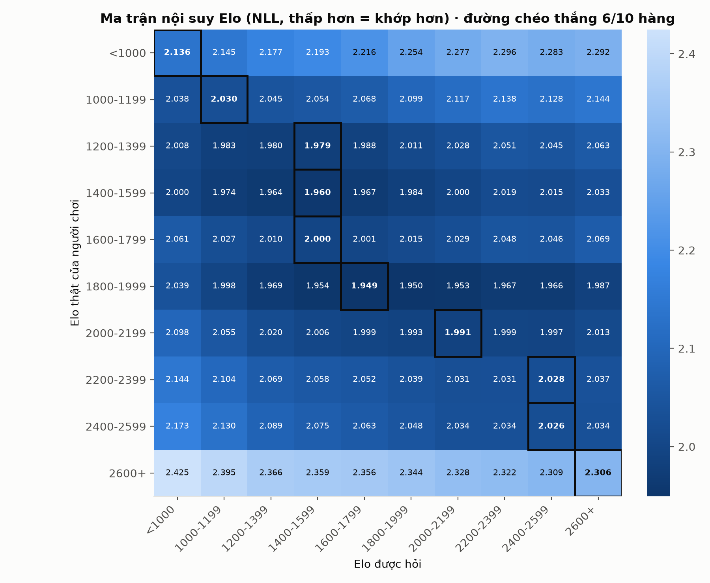

# Kết quả M2 — `m2-rtx5060ti-v2`

Sinh tự động bởi `ml/scripts/build_m2_report.py`; đừng sửa tay (chạy lại sẽ ghi đè).
Nhận xét viết tay để trong `NOTES.md` cùng thư mục.

## Số liệu chính (tập test)

| Chỉ số | Giá trị |
| --- | --- |
| Top-1 | 39.49% |
| Top-3 | 67.18% |
| Top-1 khi bỏ qua Elo | 39.03% |
| Đóng góp của Elo | +0.46 điểm % |
| Đoán đều mọi nước hợp lệ | 5.75% |
| Stockfish depth 12 top-1 (3,000 vị trí) | 39.07% |
| Đường chéo ma trận nội suy thắng | 1/10 hàng |
| Đường chéo thắng theo NLL | 6/10 hàng (lệch TB 0.40 dải) |
| MAE ước lượng Elo (80 nước, 300 người) | 428 |
| Số vị trí test | 148,183 |
| Loss validation thấp nhất | 2.0243 (bước 7,000) |

## Dữ liệu

- Nguồn: https://database.lichess.org/standard/lichess_db_standard_rated_2026-09.pgn.zst (CC0 (Lichess open database))
- 9,234,922 ván đã đọc, 121,933 ván được dùng, 63,662 người chơi · dừng vì: mọi dải Elo đã đủ
- Lấy mẫu train: tối đa 8 vị trí mỗi bên/ván, 3000 vị trí mỗi người
- Split: train 1,707,397, test 148,183, val 144,420 vị trí (chia theo ván)

## Mô hình

- ResNet 10 khối × 128 kênh, FiLM theo Elo (elo_dim 64); checkpoint tốt nhất ở bước 9,000

## Hình















## File

- `data/`: dữ liệu gốc (JSON) — đủ để vẽ lại mọi hình
- `tables/`: bảng CSV (UTF-8 có BOM, mở thẳng bằng Excel)
- `figures/`: PNG 200 dpi

## Tái lập

```powershell
cd ml
python scripts/build_m2_report.py --run runs/m2-rtx5060ti-v2 --data data/m2-v2
```
