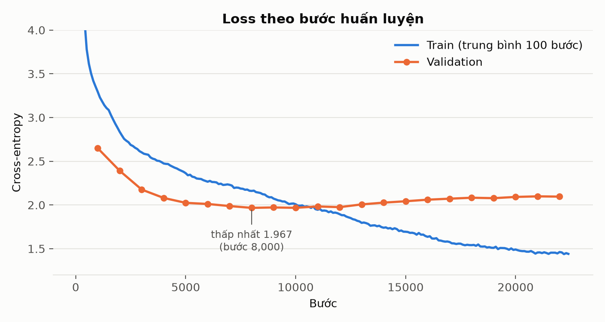
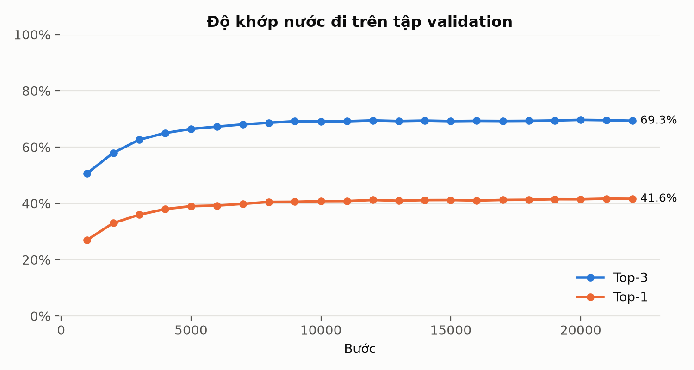
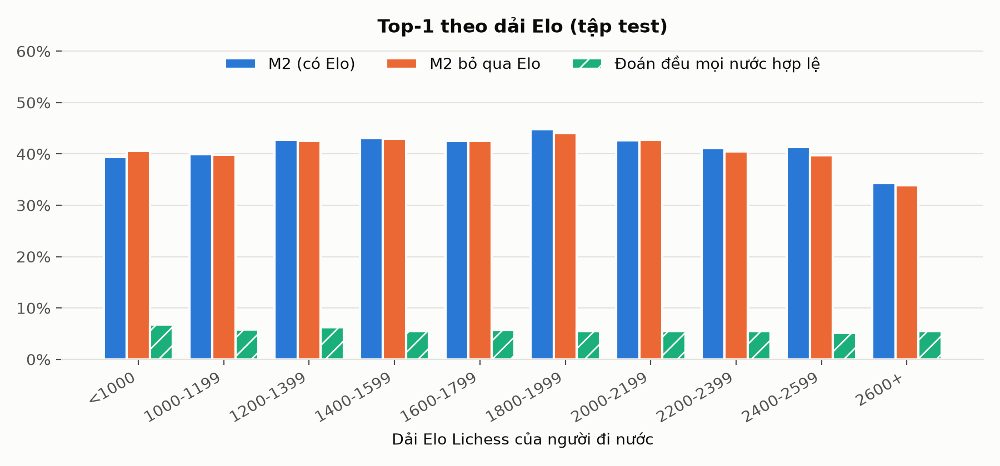
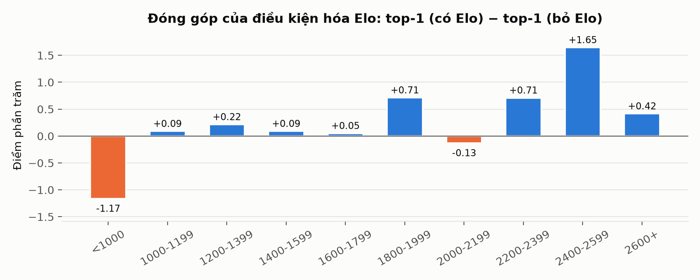
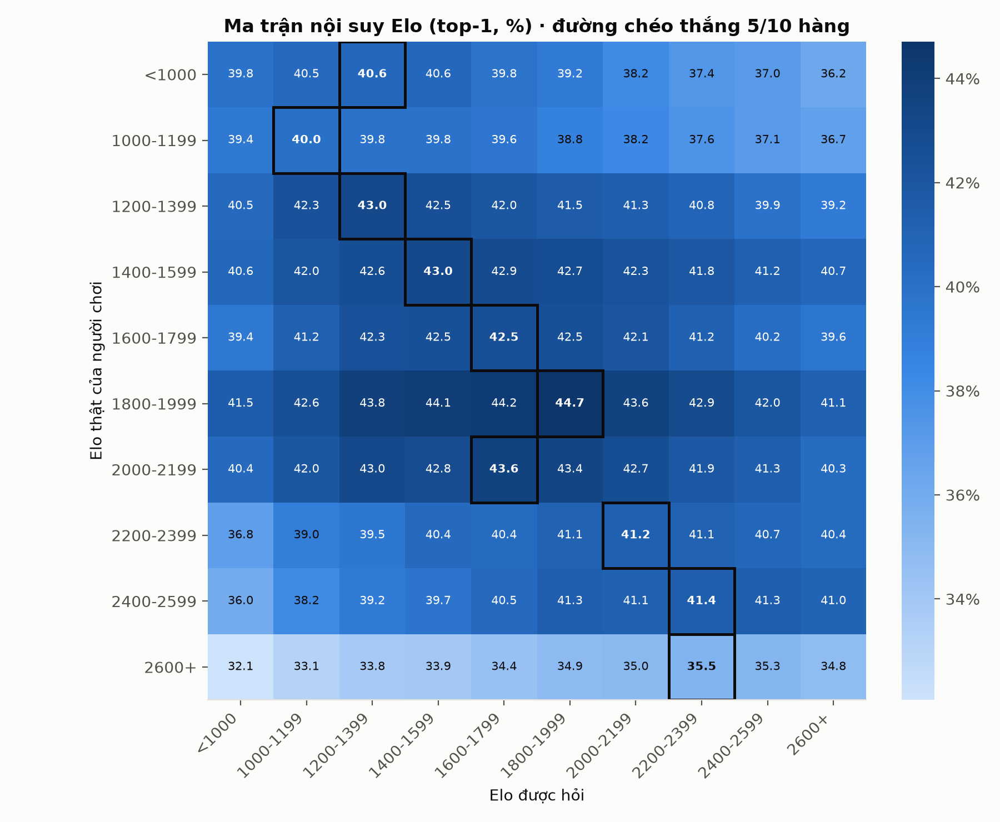
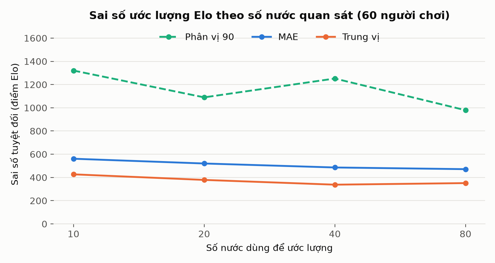

# Kết quả M2 — `m2-rtx5060ti`

Sinh tự động bởi `ml/scripts/build_m2_report.py`; đừng sửa tay (chạy lại sẽ ghi đè).
Nhận xét viết tay để trong `NOTES.md` cùng thư mục.
Loss train của run này được trích từ log console (run chạy trước khi có `train_log.jsonl`).

## Số liệu chính (tập test)

| Chỉ số | Giá trị |
| --- | --- |
| Top-1 | 41.39% |
| Top-3 | 69.12% |
| Top-1 khi bỏ qua Elo | 41.12% |
| Đóng góp của Elo | +0.27 điểm % |
| Đoán đều mọi nước hợp lệ | 5.71% |
| Đường chéo ma trận nội suy thắng | 5/10 hàng |
| MAE ước lượng Elo (80 nước, 60 người) | 471 |
| Số vị trí test | 43,273 |
| Loss validation thấp nhất | 1.9667 (bước 8,000) |

## Dữ liệu

- Nguồn: https://database.lichess.org/standard/lichess_db_standard_rated_2026-09.pgn.zst (CC0 (Lichess open database))
- 1,911,090 ván đã đọc, 34,531 ván được dùng · dừng vì: mọi dải Elo đã đủ
- Split: train 1,915,486, test 43,273, val 41,241 vị trí (chia theo ván)

## Mô hình

- ResNet 10 khối × 128 kênh, FiLM theo Elo (elo_dim 64); checkpoint tốt nhất ở bước 21,000

## Hình













## File

- `data/`: dữ liệu gốc (JSON) — đủ để vẽ lại mọi hình
- `tables/`: bảng CSV (UTF-8 có BOM, mở thẳng bằng Excel)
- `figures/`: PNG 200 dpi

## Tái lập

```powershell
cd ml
python scripts/build_m2_report.py --run runs/m2-rtx5060ti --data data/m2
```
